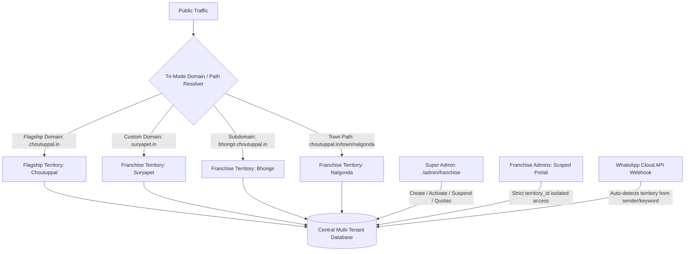

# 🚀 Choutuppal.in — Scalable Multi-Town Franchise CRM & SuperApp Platform

A production-grade, multi-tenant SaaS platform extending the flagship **Choutuppal.in** ecosystem into a scalable, multi-town franchise network without data loss or feature breakage.

Built with **Next.js 15 (App Router)**, **TypeScript**, **Tailwind CSS**, **Supabase (Auth, PostgreSQL & RLS)**, and **Cloudflare R2 Storage**.

---

## 🏛️ System Architecture Overview



---

## 💎 Core Principles & Protection Guarantees

1. **Flagship Choutuppal.in Protection (`company_owned`, Immutable)**:
   - `choutuppal.in` remains the permanent company-owned flagship territory (`territory_choutuppal`).
   - All **211 original listings**, contacts, stories, and WhatsApp bot flows are preserved intact.
   - Franchise operators cannot delete, reassign, or suspend the flagship territory.
2. **Strict Backend-Level Data Isolation**:
   - Every record (`listings`, `contacts`, `stories`, `offers`, `approvals`, `messages`) contains an explicit `territoryId`.
   - Never relies solely on hiding UI buttons; every API enforces territory boundaries.
3. **Tri-Mode Domain Routing**:
   - **Custom Domain** per franchise (e.g., `suryapet.in`)
   - **Subdomain** per franchise (e.g., `bhongir.choutuppal.in`)
   - **Town-Specific Path** (e.g., `choutuppal.in/town/nalgonda`)
4. **Collision Prevention Engine**:
   - Prevents duplicate town slugs.
   - Blocks duplicate domain claims across different territories.
   - Forbids recreating or hijacking the `choutuppal` slug.
5. **WhatsApp Multi-Tenant Bot Isolation**:
   - Automatically detects the user's territory via sender phone match, town keywords, or bot phone number.
   - Inbound listing submissions route into the specific territory's approval queue.
   - Automated replies dynamically use the town's Telugu name, local contact phone, and town domain.
6. **Tamper-Evident Security & Audit Trail**:
   - Privileged operations (`FRANCHISE_CREATED`, `FRANCHISE_STATUS_ACTIVE`, `FRANCHISE_STATUS_SUSPENDED`, `FRANCHISE_PLAN_UPDATED`, etc.) are recorded in an immutable audit log.

---

## 📋 Lifecycle States for Town Franchises

| Status | Meaning | Public Traffic | Franchise Admin Access |
| :--- | :--- | :--- | :--- |
| `application_submitted` | Initial inbound application via web or WhatsApp | Not visible | No access |
| `under_review` | Super Admin verifying territory & applicant credentials | Not visible | No access |
| `approved_pending_setup` | Approved; domains and quotas assigned, awaiting final launch | Coming soon notice | Staging access |
| `active` | Fully operational with 1-year renewable SaaS license | Live listings & bot | Full portal access |
| `suspended` | Paused (e.g., overdue royalties or compliance breach) | Under maintenance notice | Locked out |
| `expired` | License term expired, renewal required | Paused | Read-only |
| `closed` | Permanently decommissioned | 404 Not Found | Revoked |
| `rejected` | Application rejected by Super Admin | Not provisioned | None |

---

## ⚡ Super Admin Endpoints & Capabilities

### 1. Super Admin Franchise Network Dashboard
- **URL**: `https://choutuppal.in/admin/franchise`
- **Features**:
  - Network overview metric cards (Total Franchises, Active Towns, Flagship Status, Pending Setup, Suspended).
  - Protected Flagship Choutuppal Banner with immutable status badge.
  - Interactive **"Add Town Franchise" Wizard** with real-time collision detection.
  - Lifecycle action controls: **Activate**, **Suspend**, **Reactivate**, **Modify Plan**.
  - **Single-Use WhatsApp Magic Login Link Generator** for franchise partners.
  - Real-time **Multi-Tenant Security & Audit Trail** feed.

### 2. Multi-Tenant Franchise API
- **Endpoint**: `/api/admin/franchises`
- **Actions**:
  - `GET`: Fetch network stats, franchises list, territories, domains, and audit trail. Supports `?territoryId=...`.
  - `POST action="create"`: Validates against collisions, provisions Territory, Franchise, Domain, Quotas, and logs audit event.
  - `POST action="update_status"`: Updates status (`active`, `suspended`, etc.), synchronizes territory status, sets 1-year expiry on activation.
  - `POST action="update_plan"`: Customizes plan tier (`STARTER`, `PRO`, `ENTERPRISE`), max listings quota, and staff limits.

### 3. Town-Specific Public Website Routing
- **URL**: `https://choutuppal.in/town/[slug]` (e.g., `/town/suryapet`, `/town/bhongir`, `/town/nalgonda`)
- **Features**:
  - Town-specific branding and Telugu/English headlines.
  - Coverage locality pills.
  - Scoped listings grid with photos, WhatsApp buttons, and call triggers.
  - Graceful "Coming Soon / Maintenance" notices for unlaunched or suspended towns.

### 4. Multi-Tenant WhatsApp Webhook
- **Endpoint**: `/api/whatsapp/webhook`
- **Capabilities**:
  - Resolves inbound messages to the correct territory.
  - Directs vendor listing claims and submissions into that territory's approval queue.
  - Dispatches localized auto replies for Taxi, Auto, Plumber, Electrician, and Real Estate.

---

## 🧪 Verification & Integration Test Suite

The platform includes an automated Python test suite verifying all 16 multi-tenant guarantees:

```bash
python3 test_franchise_platform.py
```

### Verification Results:
```
=== Phase 3: Flagship Choutuppal Protection & Backfill ===
  ✔ PASS: Flagship Choutuppal territory exists with company_owned & isFlagship status
  ✔ PASS: All 211 listings safely backfilled to territory_choutuppal without data loss
  ✔ PASS: Flagship Choutuppal is strictly immutable and protected against suspension

=== Phase 4 & 6: Franchise Creation, Quotas & Collision Detection ===
  ✔ PASS: Collision check successfully blocked attempt to recreate Flagship 'Choutuppal'
  ✔ PASS: Successfully onboarded 'Nalgonda SuperApp Franchise' with territory, domain, and quotas
  ✔ PASS: Territory slug collision check successfully blocked duplicate 'Nalgonda' creation
  ✔ PASS: Domain collision check successfully blocked reuse of claimed domain 'nalgonda.in'

=== Phase 6: Franchise Lifecycle Transitions & Territory Sync ===
  ✔ PASS: Franchise activation verified with 1-year license expiry timestamp
  ✔ PASS: Franchise suspension correctly synchronized territory status to 'suspended'
  ✔ PASS: Franchise reactivation successfully restored territory status to 'active'

=== Phase 10: Plan Quota Enforcement & Scoped Data Isolation ===
  ✔ PASS: Franchise plan successfully upgraded to ENTERPRISE with 2500 listing limit
  ✔ PASS: Listing created and strictly scoped to 'territory_nalgonda'
  ✔ PASS: Data isolation verified: Flagship Choutuppal and Nalgonda listings remain completely isolated

=== Phase 7: Tri-Mode Domain & Territory Resolver Engine ===
  ✔ PASS: Domain 'choutuppal.in' resolves to Flagship Choutuppal
  ✔ PASS: Custom domain 'suryapet.in' resolves to territory_suryapet
  ✔ PASS: Subdomain 'bhongir.choutuppal.in' resolves to territory_bhongir
  ✔ PASS: Town slug 'nalgonda' resolves to territory_nalgonda

=== Phase 10: Security & Audit Logging ===
  ✔ PASS: Audit log verified for privileged action: FRANCHISE_CREATED
  ✔ PASS: Audit log verified for privileged action: FRANCHISE_STATUS_ACTIVE
  ✔ PASS: Audit log verified for privileged action: FRANCHISE_STATUS_SUSPENDED
  ✔ PASS: Audit log verified for privileged action: FRANCHISE_PLAN_UPDATED
```

---

## 🚀 Deployment Instructions

### 1. Vercel Deployment
1. Import this repository into your Vercel team account.
2. Ensure Environment Variables are configured:
   - `NEXT_PUBLIC_APP_URL=https://choutuppal.in`
   - `NEXT_PUBLIC_SUPABASE_URL=https://your-supabase.supabase.co`
   - `NEXT_PUBLIC_SUPABASE_ANON_KEY=your-anon-key`
   - `SUPABASE_SERVICE_ROLE_KEY=your-service-role-key`
   - `WHATSAPP_CLOUD_API_TOKEN=your-token`
   - `WHATSAPP_PHONE_NUMBER_ID=your-id`
   - `WHATSAPP_VERIFY_TOKEN=choutuppal_verify_token`
   - `R2_ACCOUNT_ID`, `R2_ACCESS_KEY_ID`, `R2_SECRET_ACCESS_KEY`, `R2_BUCKET_NAME`
3. Click **Deploy**.

### 2. Wildcard & Custom Domain Configuration
- In Vercel Project Settings → Domains:
  - Add `choutuppal.in` (Flagship Primary)
  - Add `*.choutuppal.in` (Wildcard for all franchise subdomains)
  - Add custom franchise domains (e.g. `suryapet.in`, `nalgonda.in`) as required.

### 3. Supabase Database Migration
Run `supabase/schema.sql` in your Supabase SQL Editor. It sets up all multi-tenant tables (`territories`, `franchises`, `territory_domains`, `listings`, `approvals`, `contacts`, `audit_logs`) and enforces Row Level Security policies.
