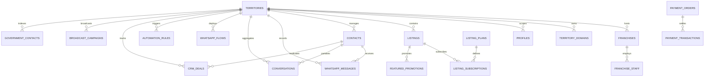

# Supabase Database Architecture & Entity Specifications

**Project**: Choutuppal WhatsApp CRM & Multi-Town Platform  
**Target Domain**: [choutuppal.in](https://choutuppal.in)  
**Database**: PostgreSQL 17.11 (Supabase Hosted)  
**Project Ref**: `llcfxewxqrmdzlvnzzxm`  
**Date**: October 29, 2026  

---

## 1. Entity-Relationship Diagram (ERD)

---

## 2. Comprehensive Entity Catalog (29 Tables)

### Group A: Multi-Tenant Platform Core (11 Tables)
1. **`public.territories`**: Multi-town partition anchor.
   - `id` (TEXT, PK, e.g. `territory_choutuppal`), `name`, `slug`, `type` (`company_owned` / `franchise_operated`), `status`, `district`, `state`, `pincodes` (TEXT[]), `localities` (TEXT[]), `primary_domain`, `subdomain`, `is_flagship`, `branding` (JSONB), `contact_phone`, `whatsapp_number`.
2. **`public.franchises`**: Town franchise operators & licensing terms.
   - `id` (TEXT, PK), `territory_id` (FK -> `territories`), `name`, `applicant_name`, `applicant_phone`, `email`, `status`, `owner_user_id` (UUID), `plan_tier`, `feature_limits` (JSONB), `commercial_model` (JSONB), `assigned_domain`, `activated_at`, `expires_at`.
3. **`public.territory_domains`**: Custom domains and SSL mapping.
   - `id` (TEXT, PK), `territory_id` (FK -> `territories`), `domain` (UNIQUE), `type` (`PRIMARY` / `SUBDOMAIN` / `ALIAS`), `is_verified`, `ssl_status`.
4. **`public.profiles`**: User accounts mapped to Supabase Auth.
   - `id` (UUID, PK -> `auth.users`), `phone`, `full_name`, `avatar_url`, `role` (`SUPER_ADMIN`, `FRANCHISE_ADMIN`, `MERCHANT`, `USER`), `territory_id` (FK -> `territories`), `franchise_id` (FK -> `franchises`).
5. **`public.franchise_staff`**: Sub-operator staff per town.
   - `id` (TEXT, PK), `franchise_id` (FK), `territory_id` (FK), `user_id` (UUID), `name`, `phone`, `email`, `role`, `permissions` (TEXT[]), `status`.
6. **`public.listings`**: Verified business, services, and property listings.
   - `id` (TEXT, PK), `territory_id` (FK), `franchise_id` (FK), `title`, `slug`, `category_id`, `category_name`, `village_id`, `village_name`, `type`, `phone`, `whatsapp`, `address`, `cover_image`, `gallery` (TEXT[]), `status`, `is_featured`, `is_premium`, `views`, `whatsapp_clicks`.
7. **`public.approvals`**: Moderation queue for UGC & new merchants.
   - `id` (TEXT, PK), `territory_id` (FK), `type`, `title`, `submitter_name`, `submitter_phone`, `data` (JSONB), `status`, `rejection_reason`.
8. **`public.stories`**: 24-hour merchant photo stories.
   - `id` (TEXT, PK), `territory_id` (FK), `business_id`, `media_url`, `caption`, `status`, `expires_at`.
9. **`public.offers`**: Promotional discounts and vouchers.
   - `id` (TEXT, PK), `territory_id` (FK), `business_id`, `title`, `discount`, `terms`, `start_date`, `end_date`, `status`.
10. **`public.contacts`**: CRM merchant leads and inbound inquiries.
    - `id` (TEXT, PK), `territory_id` (FK), `name`, `phone`, `email`, `tags` (TEXT[]), `stage` (`NEW_LEAD`, `CONTACTED`, `QUALIFIED`, `WON`, `LOST`), `notes`, `message_count`, `last_contact_at`.
11. **`public.audit_logs`**: Append-only tamper-proof administrative trail.
    - `id` (TEXT, PK), `actor_id`, `actor_name`, `actor_role`, `territory_id` (FK), `action`, `details`, `metadata` (JSONB), `ip_address`, `created_at`.

---

### Group B: CRM & WhatsApp Automation (8 Tables)
12. **`public.whatsapp_messages`**: Real-time incoming & outgoing message log.
    - `id` (TEXT, PK), `territory_id` (FK), `contact_id` (FK), `phone`, `direction` (`INBOUND` / `OUTBOUND`), `sender`, `text`, `message_type`, `status` (`sent`, `delivered`, `read`, `failed`), `provider_message_id`, `timestamp`.
13. **`public.conversations`**: Unified thread summary per phone.
    - `id` (TEXT, PK), `territory_id` (FK), `contact_id` (FK), `phone`, `last_message_text`, `last_message_direction`, `unread_count`, `status`.
14. **`public.whatsapp_flows`**: Interactive bot decision trees.
    - `id` (TEXT, PK), `territory_id` (FK), `name`, `trigger_type`, `trigger_keywords` (TEXT[]), `initial_message`, `button_options` (TEXT[]), `nodes` (JSONB), `is_active`.
15. **`public.automation_rules`**: 179 event-driven business rules.
    - `id` (TEXT, PK), `territory_id` (FK), `name`, `trigger_type`, `trigger_value`, `action_type`, `action_value`, `delay_minutes`, `is_active`.
16. **`public.automation_logs`**: Rule execution and audit events.
    - `id` (TEXT, PK), `territory_id` (FK), `automation_id` (FK), `contact_id` (FK), `trigger_type`, `action_type`, `status`, `details`.
17. **`public.crm_deals`**: Lead pipelines, deal stages, and revenue tracking.
    - `id` (TEXT, PK), `territory_id` (FK), `contact_id` (FK), `listing_id` (FK), `title`, `value`, `currency`, `stage`, `status`.
18. **`public.broadcast_campaigns`**: Bulk WhatsApp broadcast scheduler.
    - `id` (TEXT, PK), `territory_id` (FK), `name`, `target_tags` (TEXT[]), `message_text`, `scheduled_at`, `status`, `sent_count`, `delivered_count`.
19. **`public.webhook_events`**: Idempotent webhook deduplication table.
    - `id` (TEXT, PK), `provider`, `event_id`, `event_type`, `payload_hash`, `payload` (JSONB), `status`.

---

### Group C: Content, Directory & Monetization (10 Tables)
20. **`public.news_items`**: Local community journalism & updates.
21. **`public.short_items`**: 9:16 short video showcases.
22. **`public.banner_items`**: Clickable advertising displays.
23. **`public.ticker_items`**: Urgent announcements & news headlines.
24. **`public.government_contacts`**: Public emergency, police, revenue, and utility directory.
25. **`public.listing_plans`**: Subscription tiers (Starter, Premium, Featured, Bundle).
26. **`public.listing_subscriptions`**: Active merchant billing contracts.
27. **`public.featured_promotions`**: Temporary priority boost allocations.
28. **`public.payment_orders`**: Internal and gateway transaction orders.
29. **`public.payment_transactions`**: Gateway signature confirmations and receipt logs.
