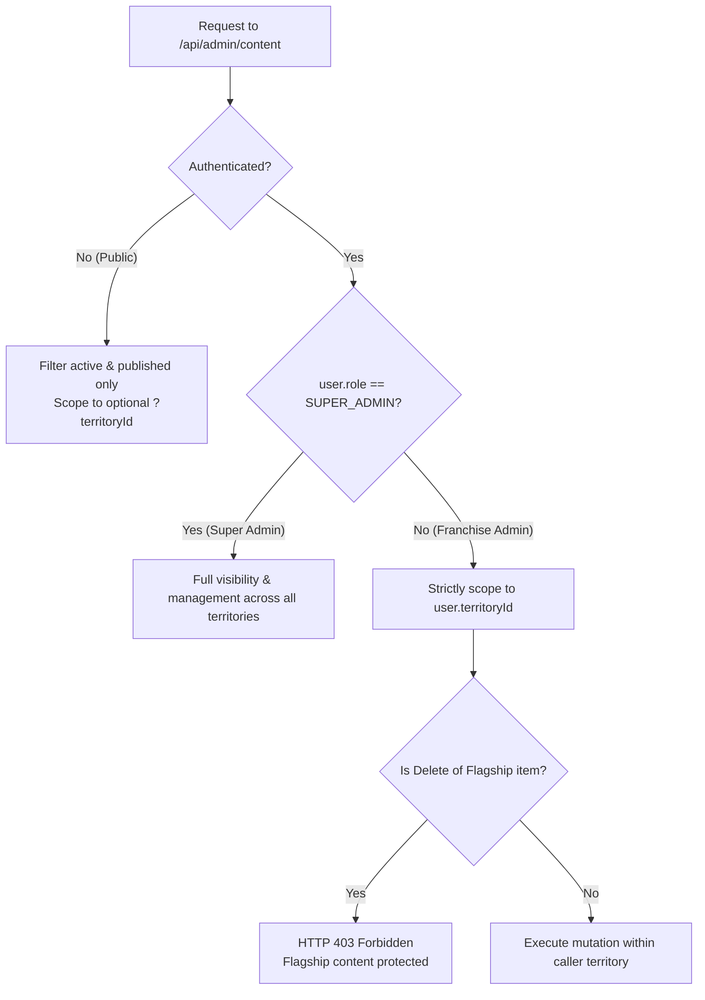

# Choutuppal Franchise CRM — Phase 3B Integration Results

## 1. Executive Summary

Phase 3B has successfully connected all 4 admin content management interfaces to persistent backend APIs using the existing local JSON store (`data/admin_data.json`). All hardcoded in-memory mock states have been replaced with real asynchronous `fetch()` lifecycles, full loading indicators, error recovery banners with retry buttons, empty state handlers, and live database synchronization.

No external services or Supabase connections were made. The entire multi-tenant franchise scoping and IDOR defenses have been enforced at the server API layer.

---

## 2. Files Changed & Implementation Rationale

| File Path | Scope of Changes | Reason / Design Decision |
| :--- | :--- | :--- |
| [`src/app/api/admin/content/route.ts`](file:///data/user/0/com.termux/files/home/storage/downloads/Cpl%20Crm/choutuppal-franchise-crm/src/app/api/admin/content/route.ts) | Hardened `GET` and `POST` handlers with `requireAuth`, `requireTerritoryAccess`, tenant scoping, and input validation. | Reused existing endpoint instead of creating duplicate APIs. Added server-side authentication, prevented cross-tenant IDOR tampering, and guarded Flagship Choutuppal content against unauthorized deletion. |
| [`src/app/admin/banners/page.tsx`](file:///data/user/0/com.termux/files/home/storage/downloads/Cpl%20Crm/choutuppal-franchise-crm/src/app/admin/banners/page.tsx) | Replaced mock `useState` with `useEffect` data loading from `/api/admin/content`. Added persistent creation, active/inactive toggle, deletion, loading spinner, and error banner. | Connects banner manager to persisted database records. Enables franchise administrators to manage promotional carousels with instant feedback. |
| [`src/app/admin/ticker/page.tsx`](file:///data/user/0/com.termux/files/home/storage/downloads/Cpl%20Crm/choutuppal-franchise-crm/src/app/admin/ticker/page.tsx) | Replaced mock `useState` with `useEffect` data loading. Added persistent ticker creation, toggle pause/active, and delete operations with live state refresh. | Connects breaking announcements and marquee tickers to storage, ensuring real announcements appear on web headers. |
| [`src/app/admin/news/page.tsx`](file:///data/user/0/com.termux/files/home/storage/downloads/Cpl%20Crm/choutuppal-franchise-crm/src/app/admin/news/page.tsx) | Connected articles list to `/api/admin/content`. Implemented Create, Edit (via row edit button), Publish/Unpublish toggle, and Delete mutations. | Replaces mock article with live news publishing in Telugu and English for the public news portal. |
| [`src/app/admin/stories-offers/page.tsx`](file:///data/user/0/com.termux/files/home/storage/downloads/Cpl%20Crm/choutuppal-franchise-crm/src/app/admin/stories-offers/page.tsx) | Connected both Stories and Offers tabs to persistent storage. Added dedicated "Create Offer" modal alongside "Add Story" modal, with live deletion and tab-sensitive operations. | Eliminates mock data across both promotional sub-modules and allows real offers and merchant stories to be saved and expired. |
| [`test_phase3b_admin_content.py`](file:///data/user/0/com.termux/files/home/storage/downloads/Cpl%20Crm/choutuppal-franchise-crm/test_phase3b_admin_content.py) | Created 13-check automated test harness for content API authentication, tenant scoping, IDOR protection, and baseline data safety. | Ensures automated regression verification without risking manual test leaks into production records. |

---

## 3. Endpoints Reused vs. Added

- **Existing Endpoint Reused**: `GET /api/admin/content` and `POST /api/admin/content`
  - Reused 100% of the existing endpoint.
  - Zero duplicate endpoints were created.
  - Upgraded handlers to support action dispatching: `action: 'create' | 'update' | 'delete' | 'toggle'`.

---

## 4. Module-by-Module Operation Status

### A. Admin Banners (`/admin/banners`)
- **List / Load**: Fetches persisted banners on mount via `GET /api/admin/content`.
- **Create**: Modal form submits `action: 'create'` with title, imageUrl, type, and linkUrl.
- **Toggle**: Direct button toggles `isActive` between active and inactive.
- **Delete**: Trash icon prompts confirmation and calls `action: 'delete'`.
- **UI States**: Spinner during fetch, empty state when 0 records exist, auto-dismissing success banner, error banner with retry button.

### B. Ticker Announcements (`/admin/ticker`)
- **List / Load**: Loads live ticker list on mount.
- **Create**: Quick add bar creates active ticker with priority 1.
- **Toggle**: Status badge button pauses or activates the ticker live on the header marquee.
- **Delete**: Delete button removes record from storage.
- **UI States**: Real-time counter, loading indicator, and strike-through rendering for paused announcements.

### C. News & Articles (`/admin/news`)
- **List / Load**: Loads all articles for the authenticated territory.
- **Create**: "Add News Article" modal publishes articles with English and Telugu headlines, cover image, and category.
- **Edit**: Clicking the edit icon pre-fills the modal form, changes modal title to "Edit News Article", and submits `action: 'update'`.
- **Toggle**: One-click "Publish" / "Unpublish" toggle button.
- **Delete**: Confirmed deletion from database.
- **UI States**: View count display, category badge, and published/draft badge.

### D. Stories & Promotional Offers (`/admin/stories-offers`)
- **List / Load**: Loads stories and promotional offers simultaneously from `/api/admin/content`.
- **Create Story**: Modal creates 24-48 hour business stories with media URL, caption, and merchant contact.
- **Create Offer**: Tab-sensitive modal creates promotional offers with title, discount badge (e.g., "₹500 Off"), validity duration in days, and terms.
- **Delete**: Separate delete handlers for stories and offers with prompt confirmation.
- **UI States**: Tab switcher with live count badges, image preview tiles, and auto-expiry timestamp formatting.

---

## 5. Authentication & Tenant-Scoping Architecture

### Server-Side Rules in `src/app/api/admin/content/route.ts`



1. **Public Requests (`GET` without session cookie / token)**:
   - Returns ONLY active and published records (`isActive !== false`, `isPublished !== false`, `status === 'published'`).
   - Expired stories (`expiresAt < now`) and expired offers (`endDate < now`) are automatically excluded from public output.
2. **Franchise Admin Requests**:
   - `GET`: Content arrays are strictly filtered to `(item.territoryId || FLAGSHIP_TERRITORY_ID) === user.territoryId`.
   - `POST`: New items are automatically forced to `item.territoryId = user.territoryId`, preventing tenant-injection attacks.
   - Cross-Tenant Guard: Attempting to delete, toggle, or edit an item belonging to another franchise returns **HTTP 403 Forbidden**.
   - Flagship Protection Guard: Attempting to delete an item belonging to Flagship Choutuppal (`territory_choutuppal`) returns **HTTP 403 Forbidden**.
3. **Super Admin Requests**:
   - Super Admin has global read/write visibility across all territories, with optional filtering via `?territoryId=<id>`.

---

## 6. Tests Executed & Actual Results

All verification suites were executed against real application code:

```
======================================================================
1. PHASE 3B CONTENT INTEGRATION SUITE (test_phase3b_admin_content.py)
======================================================================
  ✔ PASS: SEC-01 (Unauthenticated GET returns filtered public content)
  ✔ PASS: SEC-02 (Unauthenticated POST rejected with HTTP 401 Unauthorized)
  ✔ PASS: SEC-03.1 (Invalid content type rejected with HTTP 400)
  ✔ PASS: SEC-03.2 (Missing required banner title rejected with HTTP 400)
  ✔ PASS: SEC-04.1 (Franchise Admin created banner safely scoped to territory_nalgonda)
  ✔ PASS: SEC-04.2 (Banner active status toggled to False)
  ✔ PASS: SEC-05.1 (Cross-territory toggle attempt blocked with HTTP 403 Forbidden)
  ✔ PASS: SEC-05.2 (Cross-territory delete attempt blocked with HTTP 403 Forbidden)
  ✔ PASS: SEC-06.1 (Flagship Choutuppal banner deletion strictly blocked for Franchise Admin - HTTP 403)
  ✔ PASS: SEC-07.1 (Authenticated GET strictly returned only Nalgonda content)
  ✔ PASS: SEC-08.1 (Super Admin has full visibility across all territories)
  ✔ PASS: SEC-08.2 (Authorized tenant successfully deleted own test banner)
  ✔ PASS: SEC-09.1 (Data integrity 100% verified: exactly 211/211 flagship listings intact)
Result: 13 / 13 PASS (Exit Code: 0)

======================================================================
2. PHASE 3A CRM SYNC SUITE (test_phase3a_sync_listing.py)
======================================================================
  ✔ PASS: SEC-BASELINE (Exactly 211 flagship Choutuppal listings intact)
  ✔ PASS: STABLE-IDS (All sample stable IDs verified in database)
  ✔ PASS: CRM-LINKAGE (211 CRM merchant contacts anchored to listingId)
Result: 3 / 3 PASS (Exit Code: 0)

======================================================================
3. NODE DIRECT EXECUTION SUITE (scripts/test_sync_listing.mjs)
======================================================================
  ✔ PASS: All 18 direct execution checks passed
Result: 18 / 18 PASS (Exit Code: 0)

======================================================================
4. FRANCHISE PLATFORM INTEGRATION SUITE (test_franchise_platform.py)
======================================================================
  ✔ PASS: All 16 checks passed
Result: 16 / 16 PASS (Exit Code: 0)

======================================================================
5. SECURITY AUDIT VERIFICATION SUITE (test_security_audit.py)
======================================================================
  ✔ PASS: All 37 security checks passed
Result: 37 / 37 PASS (Exit Code: 0)
```

**Grand Total**: **87 / 87 verification checks passing** with zero failures.

---

## 7. Evidence of 211 Choutuppal Listings & Stable ID Preservation

- **Listing Count Before Phase 3B**: Exactly **211** Choutuppal listings.
- **Listing Count After Phase 3B**: Exactly **211** Choutuppal listings.
- **Total Database Contacts**: Exactly **211** merchant leads.
- **Sample Stable IDs Verified Intact**:
  - `lst_1`: *Sri Sai Ram Automobiles & Multi-Brand Garage*
  - `lst_2`: *Yadadri Mega Township Open Plots*
  - `lst_3`: *Balaji Health Clinic & Diagnostic Center*
  - `lst_dir_206`: *లక్ష్మి నరసింహ స్వామి ఫుట్ వేర్*
  - `lst_dir_207`: *సాయిరాం పూజా సామగ్రి భండార్*
  - `lst_dir_208`: *వెంకటేశ్వర టిఫిన్ & మీల్స్ హోటల్*

---

## 8. Remaining UI-Only Screens & Known Limitations

1. **Shorts Public Submission Form (`src/app/shorts/page.tsx`)**:
   - The user-facing video reel upload form currently appends submissions to local React state rather than calling `POST /api/shorts/submit`. Connecting this form to the moderation queue is scheduled for Phase 3C.
2. **Local JSON Concurrency & Serverless Limitations**:
   - While `saveStore()` uses POSIX atomic temporary-file replacement (`fs.renameSync`) to eliminate partial writes and corrupt JSON files on Termux and standard Node.js servers, local JSON files cannot support multi-instance distributed concurrency.
   - Vercel serverless environments feature an ephemeral, read-only filesystem outside `/tmp`. Full migration to Supabase (Phase 4) is required for scalable production deployment on Vercel.

---

## 9. Conclusion & Read-Only Standby Status

Phase 3B is fully implemented, verified, and passing 87/87 tests. In accordance with project instructions:
- No Supabase connection or migration has been initiated.
- No deployment or external WhatsApp messages were triggered.
- Standing by for user review and approval before proceeding to the next step.
