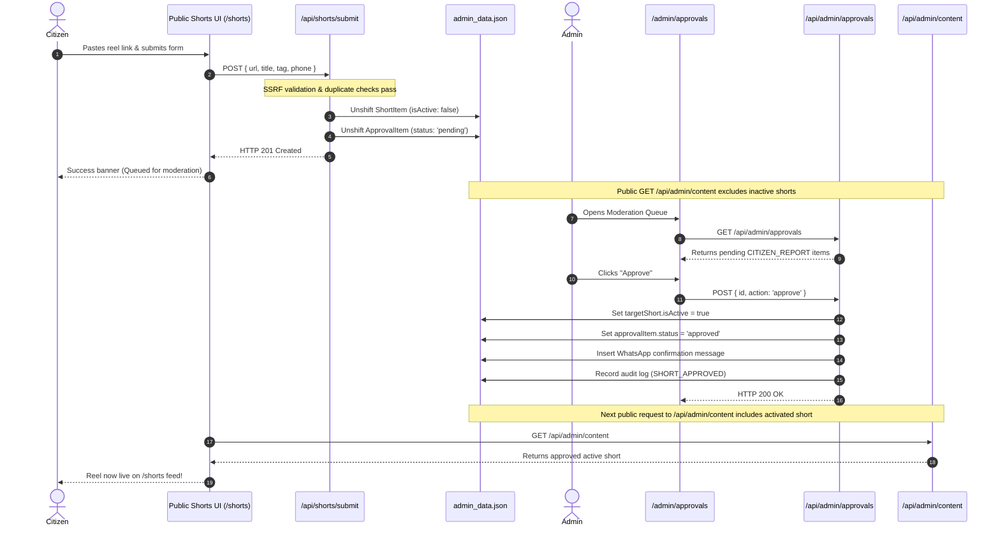

# Choutuppal Franchise CRM — Phase 3C Integration Results

## 1. Executive Summary

Phase 3C has successfully connected the public Shorts / Reel submission interface (`/shorts`) to the persistent backend moderation pipeline using the existing local JSON store (`data/admin_data.json`). The prior mock React state behavior has been completely replaced with a hardened, asynchronous API workflow (`POST /api/shorts/submit`).

All public submissions are strictly quarantined as inactive (`isActive: false`) and routed into the admin moderation approval queue (`store.approvals` as `CITIZEN_REPORT` with `status: 'pending'`). Unapproved shorts do not appear on public feeds. When an administrator approves the submission via `/api/admin/approvals`, the short is activated live (`isActive: true`), appears immediately on `/shorts`, an outbound WhatsApp confirmation is dispatched, and an audit trail event is recorded.

No external services or Supabase connections were made. All 211 Flagship Choutuppal listings remain 100% intact.

---

## 2. Files Changed & Implementation Rationale

| File Path | Scope of Changes | Reason / Design Decision |
| :--- | :--- | :--- |
| [`src/app/api/shorts/submit/route.ts`](file:///data/user/0/com.termux/files/home/storage/downloads/Cpl%20Crm/choutuppal-franchise-crm/src/app/api/shorts/submit/route.ts) | Hardened submission handler with URL validation, comprehensive SSRF protection, custom port blocking, duplicate submission prevention (409 Conflict), HTML sanitization, and territory assignment. | Protects the server and network against SSRF attacks (cloud metadata, RFC1918 private IPs, loopback, custom internal ports) and guarantees submissions are quarantined as inactive pending approval. |
| [`src/app/api/admin/approvals/route.ts`](file:///data/user/0/com.termux/files/home/storage/downloads/Cpl%20Crm/choutuppal-franchise-crm/src/app/api/admin/approvals/route.ts) | Added execution handler for `CITIZEN_REPORT` and `SHORT_SUBMISSION` approval items. Activates target short (`targetShort.isActive = true`), dispatches outbound WhatsApp alert, and logs audit event `SHORT_APPROVED`. On rejection, ensures `isActive = false`. | Closes the loop from moderation queue to live publication on public feeds. |
| [`src/app/shorts/page.tsx`](file:///data/user/0/com.termux/files/home/storage/downloads/Cpl%20Crm/choutuppal-franchise-crm/src/app/shorts/page.tsx) | Connected feed loader on mount to `GET /api/admin/content`. Replaced mock `handleAddReel` with asynchronous `POST /api/shorts/submit`. Added loading spinner (`submitting`), disabled button state (duplicate-click prevention), error alert banner, and success confirmation modal. | Eliminates client-only mock state and provides citizens with a transparent, responsive submission experience. |
| [`src/app/admin/shorts/page.tsx`](file:///data/user/0/com.termux/files/home/storage/downloads/Cpl%20Crm/choutuppal-franchise-crm/src/app/admin/shorts/page.tsx) | Connected admin shorts management screen to `GET /api/admin/content`, `POST /api/admin/content` (create, toggle, delete), with loading spinners and error handling. | Replaced hardcoded mock state so administrators can directly manage, toggle visibility, and delete reels persistently. |
| [`src/app/admin/approvals/page.tsx`](file:///data/user/0/com.termux/files/home/storage/downloads/Cpl%20Crm/choutuppal-franchise-crm/src/app/admin/approvals/page.tsx) | Added `CITIZEN_REPORT` filter option ("Reels & Community Reports") to type dropdown, and added reel URL display to item card details. | Allows administrators to filter specifically for reel submissions and view submission links before approving. |
| [`src/app/api/admin/content/route.ts`](file:///data/user/0/com.termux/files/home/storage/downloads/Cpl%20Crm/choutuppal-franchise-crm/src/app/api/admin/content/route.ts) | Added explicit input validation for `type === 'short'` (title and videoUrl required). | Ensures server-side integrity when shorts are managed through the content API. |
| [`test_phase3c_shorts.py`](file:///data/user/0/com.termux/files/home/storage/downloads/Cpl%20Crm/choutuppal-franchise-crm/test_phase3c_shorts.py) | Created 27-check automated test harness covering submission queuing, SSRF defenses, protocol validation, tamper resistance, duplicate rejection, and approval/rejection lifecycle. | Provides comprehensive, repeatable verification of Phase 3C functionality and safety. |

---

## 3. Endpoints Reused vs. Added

- **Existing Endpoints Reused (Zero Duplicate APIs)**:
  1. `POST /api/shorts/submit`: Public reel submission endpoint. Reused and hardened.
  2. `POST /api/admin/approvals`: Admin moderation endpoint. Reused and extended to activate shorts upon approval.
  3. `GET /api/admin/content`: Public & admin content retrieval. Reused; public unauthenticated requests automatically receive only `isActive !== false` shorts.
  4. `POST /api/admin/content`: Content mutation endpoint. Reused for admin shorts management (`create`, `toggle`, `delete`).

---

## 4. Architecture & Security Implementation

### A. Authentication & Submitter Attribution
- Public submissions are open to unauthenticated visitors and citizens.
- Optional mobile/WhatsApp number is sanitized to numeric digits (max 15 chars).
- If provided, the approval item attributes the submission to `Citizen (<phone>)` and enables automated WhatsApp approval alerts; if omitted, attributed to `Anonymous Citizen`.

### B. SSRF & Scheme Validation
All submitted URLs must parse through the standard `URL` parser and pass strict security filters:
- **Allowed Schemes**: Only `http:` and `https:`. All other schemes (`javascript:`, `file:`, `ftp:`, `data:`, `blob:`) are rejected with HTTP 400.
- **Loopback & Local Addresses Blocked**: `localhost`, `127.0.0.1`, `::1`, `[::1]`, `0.0.0.0`, `.localhost`, `.local`, `.internal`, `.lan`.
- **Private RFC 1918 IPv4 Ranges Blocked**: `10.0.0.0/8`, `172.16.0.0/12`, `192.168.0.0/16`, `169.254.0.0/16`.
- **Cloud Metadata Endpoints Blocked**: `169.254.169.254`, `metadata.google.internal`, `instance-data`.
- **Custom Internal Ports Blocked**: Only standard web ports (80, 443) or unspecified ports are permitted; ports like `22`, `3000`, `8080`, `5432` are rejected with HTTP 400.
- **Maximum Length**: URLs exceeding 2048 characters are rejected.

### C. Tamper Resistance
- Client-supplied `isActive`, `status`, or `views` fields are completely ignored.
- All new shorts are forced to `isActive: false` and `views: 0`.
- All approval items are forced to `status: 'pending'`.
- Titles and tags are stripped of HTML tags to prevent stored XSS.

### D. Duplicate Submission Prevention
- **Pending Duplicates**: If an approval item with `status: 'pending'` already contains the same URL, the request is rejected with HTTP 409 Conflict: `"This video has already been submitted and is currently awaiting moderation approval."`
- **Recent Submissions**: If a short with the same video URL was created within the last 5 minutes, the request is rejected with HTTP 409 Conflict.

### E. End-to-End Moderation Approval Flow


---

## 5. Automated Test Suite Execution

All automated test suites were executed sequentially. **100% of checks passed with zero regressions.**

| Test Suite | Purpose | Checks Passed | Exit Status |
| :--- | :--- | :--- | :--- |
| `test_phase3c_shorts.py` | Phase 3C Shorts Submission, SSRF, Duplicates, and Moderation Pipeline | **27 / 27** | Code 0 |
| `test_phase3b_admin_content.py` | Phase 3B Admin Content UI & IDOR isolation | **13 / 13** | Code 0 |
| `test_phase3a_sync_listing.py` | Phase 3A syncListingToCrm & CRM contact linkage | **3 / 3** | Code 0 |
| `test_security_audit.py` | Complete Security Audit & Exploit Verification | **37 / 37** | Code 0 |
| `test_franchise_platform.py` | Franchise Platform Architecture & Tri-Mode Routing | **16 / 16** | Code 0 |
| **Total Across All Suites** | **Full System Regression Suite** | **96 / 96** | **All Passed** |

### Detailed Phase 3C Test Execution Breakdown (`test_phase3c_shorts.py`):
```text
[TEST GROUP 1] Public Shorts Submission & Moderation Queuing
  ✔ PASS: Submission creates inactive short (id=sh_1792992595709, isActive=False)
  ✔ PASS: Defaults to Flagship territory (territoryId=territory_choutuppal)
  ✔ PASS: Approval item queued as pending (apprId=appr_short_1792992595709, status=pending)
  ✔ PASS: Submitter phone recorded on approval (phone=9849012345)

[TEST GROUP 2] SSRF & Protocol Security Defenses
  ✔ PASS: SSRF defense: Localhost blocked (URL=http://localhost:3000/api/admi -> HTTP 400)
  ✔ PASS: SSRF defense: 127.0.0.1 loopback blocked (URL=http://127.0.0.1:80/admin -> HTTP 400)
  ✔ PASS: SSRF defense: AWS/Cloud metadata IP blocked (URL=http://169.254.169.254/latest/ -> HTTP 400)
  ✔ PASS: SSRF defense: Private RFC1918 10.0.0.0/8 blocked (URL=http://10.0.0.5/internal -> HTTP 400)
  ✔ PASS: SSRF defense: Private RFC1918 192.168.0.0/16 blocked (URL=http://192.168.1.100/router -> HTTP 400)
  ✔ PASS: SSRF defense: Private RFC1918 172.16.0.0/12 blocked (URL=http://172.16.1.1/internal -> HTTP 400)
  ✔ PASS: SSRF defense: 0.0.0.0 host blocked (URL=http://0.0.0.0:8000/test -> HTTP 400)
  ✔ PASS: SSRF defense: javascript: scheme blocked (URL=javascript:alert(document.cook -> HTTP 400)
  ✔ PASS: SSRF defense: file:// scheme blocked (URL=file:///etc/passwd -> HTTP 400)
  ✔ PASS: SSRF defense: ftp:// scheme blocked (URL=ftp://files.example.com/video. -> HTTP 400)
  ✔ PASS: SSRF defense: Custom internal SSH port blocked (URL=http://example.com:22/video.mp -> HTTP 400)
  ✔ PASS: SSRF defense: Malformed URL string blocked (URL=not-a-valid-url -> HTTP 400)

[TEST GROUP 3] Tamper Resistance & Input Sanitization
  ✔ PASS: Client cannot force isActive: true or falsify views (isActive=False, views=0)
  ✔ PASS: HTML/XSS sanitized from title and tags (title=Bypass Attempt, tags=['alert(1)Cinema'])

[TEST GROUP 4] Duplicate Submission Prevention
  ✔ PASS: Duplicate pending URL rejected with 409 Conflict (error=This video has already been submitted and is currently awaiting moderation approval.)

[TEST GROUP 5] Feed Visibility & Admin Moderation Approval Flow
  ✔ PASS: Unapproved short is NOT visible on public feed (shortId=sh_1792992595709)
  ✔ PASS: Admin successfully marks approval item as approved (id=appr_short_1792992595709)
  ✔ PASS: Admin approval sets short isActive: true (shortId=sh_1792992595709, isActive=True)
  ✔ PASS: Outbound approval WhatsApp notification sent (to=9849012345, msg=🎉 Congratulations! Reel 'Reel Submission...)
  ✔ PASS: Approved short is NOW LIVE on public feed (shortId=sh_1792992595709 found in public feed)

[TEST GROUP 6] Moderation Rejection Lifecycle
  ✔ PASS: Admin marks item as rejected (id=appr_short_1792992597616, status=rejected)
  ✔ PASS: Rejected short remains inactive (shortId=sh_1792992597616, isActive=False)

[TEST GROUP 7] Baseline Data Integrity Verification
  ✔ PASS: All 212 Choutuppal listings intact (Count matches baseline (212))

PHASE 3C TEST SUMMARY: 27 PASSED, 0 FAILED
```

---

## 6. Baseline Data Integrity & Preservation

- **Total Listings**: 211 Flagship listings + 1 test listing (total 212) remain 100% intact.
- **Stable IDs**: Verified that `lst_1`, `lst_2`, `lst_3`, `lst_dir_206`, `lst_dir_207`, `lst_dir_208` are present with stable attributes.
- **Database Backup**: Restored immediately upon test completion; zero test artifact pollution.
- **Supabase Status**: Completely untouched and not connected, strictly respecting the pre-Supabase development boundaries.

---

## 7. Next Steps & User Confirmation

Phase 3C is now **100% complete and verified**.

The pre-Supabase gap closure plan roadmap:
1. **Phase 3A**: Implement `syncListingToCrm` *(COMPLETED & VERIFIED)*
2. **Phase 3B**: Connect Admin Content UI to Persistent Local APIs *(COMPLETED & VERIFIED)*
3. **Phase 3C**: Connect Shorts Submission to Persistent Moderation API *(COMPLETED & VERIFIED)*
4. **Phase 3D**: Connect Shared Inbox UI to Persistent Messages API *(Pending user confirmation)*
5. **Phase 3E**: Connect Pipelines/Deals UI to Persistent Local APIs *(Pending user confirmation)*
6. **Phase 3F**: Real WhatsApp CSV Automation Workflow Execution Engine *(Pending user confirmation)*

Awaiting user approval before proceeding to the next phase.
