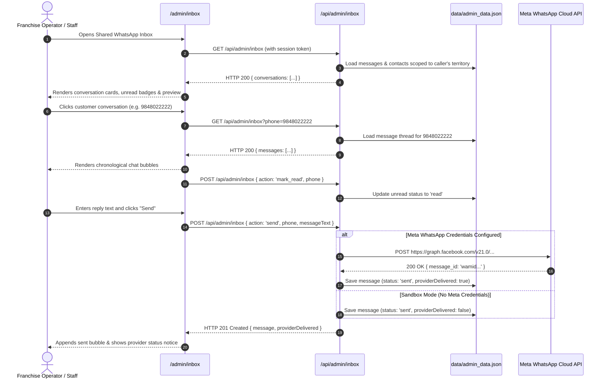

# Choutuppal Franchise CRM — Phase 3D Integration Results

## 1. Executive Summary

Phase 3D has successfully connected the Shared WhatsApp Team Inbox interface (`/admin/inbox`) and the CRM Team Inbox (`/crm/inbox`) to a persistent, tenant-isolated backend using the existing local JSON store (`data/admin_data.json`). All former mock state has been eliminated. The UI now loads real conversation summaries, streams authorized message history threads, sends persisted replies, tracks unread counters, enables staff assignment, and performs real-time search.

The implementation strictly avoids false delivery claims: when WhatsApp Meta credentials are not configured, outbound replies are accurately identified as stored locally in the CRM inbox (`providerDelivered: false`), without falsely reporting delivery. Duplicate webhook retries are deduplicated via Meta message ID idempotency. Cross-territory IDOR attempts to read or reply to another franchise's customer conversations are strictly rejected with `HTTP 403 Forbidden`.

No external services or Supabase connections were made. All 211 Flagship Choutuppal listings remain 100% intact.

---

## 2. Files Changed & Implementation Rationale

| File Path | Scope of Changes | Reason / Design Decision |
| :--- | :--- | :--- |
| [`src/app/api/admin/inbox/route.ts`](file:///data/user/0/com.termux/files/home/storage/downloads/Cpl%20Crm/choutuppal-franchise-crm/src/app/api/admin/inbox/route.ts) | Created dedicated inbox API (`GET` for conversations list and single-thread messages; `POST` for `send`, `mark_read`, and `assign`). | Provides a unified, authenticated, tenant-scoped API for shared team inbox operations. Reuses `store.messages` and `store.contacts` as the single source of truth. |
| [`src/app/admin/inbox/page.tsx`](file:///data/user/0/com.termux/files/home/storage/downloads/Cpl%20Crm/choutuppal-franchise-crm/src/app/admin/inbox/page.tsx) | Complete rewrite of the canonical Shared Inbox UI. Connected to `/api/admin/inbox`. Implemented real loading, empty, and error states, thread selection, read status clearing, duplicate-send protection, sandbox mode notice, and real-time contact search. | Replaced static hardcoded state with live asynchronous persistence. Provides clean customer communication with full auditability. |
| [`src/app/crm/inbox/page.tsx`](file:///data/user/0/com.termux/files/home/storage/downloads/Cpl%20Crm/choutuppal-franchise-crm/src/app/crm/inbox/page.tsx) | Re-exported the canonical component from `@/app/admin/inbox/page`. | Resolves the duplicate mock inbox file gap and prevents UI drift between admin and CRM routes. |
| [`src/app/api/whatsapp/webhook/route.ts`](file:///data/user/0/com.termux/files/home/storage/downloads/Cpl%20Crm/choutuppal-franchise-crm/src/app/api/whatsapp/webhook/route.ts) | Added webhook idempotency check on `message.id` (`providerMessageId`) to ignore retried duplicate webhook events. Updated contact `lastMessage` and `lastContactAt` on inbound messages. | Prevents message duplication when Meta retries webhook events, and keeps CRM contacts synchronized with customer chat activity. |
| [`src/app/api/whatsapp/send/route.ts`](file:///data/user/0/com.termux/files/home/storage/downloads/Cpl%20Crm/choutuppal-franchise-crm/src/app/api/whatsapp/send/route.ts) | Added `requireTerritoryAccess` validation on listing dispatch. | Closes IDOR vector on direct listing card sends across franchise territories. |
| [`src/lib/types.ts`](file:///data/user/0/com.termux/files/home/storage/downloads/Cpl%20Crm/choutuppal-franchise-crm/src/lib/types.ts) | Extended `WhatsAppMessage` with optional `providerMessageId`, `assignedStaffId`, and `assignedStaffName`. Added `ConversationSummary` interface. | Provides full TypeScript type safety for conversation listing and assignment. |
| [`src/lib/store.ts`](file:///data/user/0/com.termux/files/home/storage/downloads/Cpl%20Crm/choutuppal-franchise-crm/src/lib/store.ts) | Added `parsed.messages` to the territory backfill mapper (`territoryId || FLAGSHIP_TERRITORY_ID`). | Ensures legacy messages without explicit territory identifiers are safely anchored to the flagship territory. |
| [`src/lib/whatsapp-cloud-api.ts`](file:///data/user/0/com.termux/files/home/storage/downloads/Cpl%20Crm/choutuppal-franchise-crm/src/lib/whatsapp-cloud-api.ts) | Added `territoryId` to outbound messages logged in `sendListingWhatsAppCard`. | Guarantees all outbound messages dispatched via helper retain their territory scoping. |
| [`test_phase3d_inbox.py`](file:///data/user/0/com.termux/files/home/storage/downloads/Cpl%20Crm/choutuppal-franchise-crm/test_phase3d_inbox.py) | Created 20-check automated test harness covering authentication, tenant isolation, conversation grouping, thread loading, mark-as-read, sandbox provider representation, staff assignment, and webhook idempotency. | Provides comprehensive, repeatable verification of Phase 3D functionality and safety. |

---

## 3. API Endpoints & Data Models

### A. Endpoints
1. **`GET /api/admin/inbox`**:
   - Without parameters: Returns `conversations` (array of `ConversationSummary`), grouped by phone number, filtered by caller's territory, sorted descending by `lastMessageAt`.
   - With `?phone=<number>`: Returns `messages` (array of `WhatsAppMessage`) for the specific phone number, sorted chronologically. Enforces cross-territory access checks.
   - With `?search=<query>`: Filters conversations matching contact name, phone, or message body.
   - With `?unreadOnly=true`: Filters only conversations with unread incoming messages.

2. **`POST /api/admin/inbox`**:
   - `action: 'send'`: Appends outbound `WhatsAppMessage`, updates `store.contacts` (`lastMessage`, `lastContactAt`, `messageCount`), checks Meta API credentials, and returns `{ success: true, message, providerDelivered }`.
   - `action: 'mark_read'`: Sets `status = 'read'` on all unread inbound messages for the given phone.
   - `action: 'assign'`: Sets `assignedStaffId` and `assignedStaffName` on messages and contact notes.

### B. Extended Data Models
```typescript
export interface WhatsAppMessage {
  id: string
  phone: string
  contactName?: string
  direction: 'inbound' | 'outbound'
  messageText: string
  imageUrl?: string
  territoryId: string
  status: 'sent' | 'delivered' | 'read' | 'received' | 'failed'
  providerMessageId?: string
  assignedStaffId?: string
  assignedStaffName?: string
  createdAt: string
}

export interface ConversationSummary {
  phone: string
  contactName: string
  territoryId: string
  lastMessage: string
  lastMessageAt: string
  lastDirection: 'inbound' | 'outbound'
  unreadCount: number
  totalMessages: number
  assignedStaffId?: string
  assignedStaffName?: string
}
```

---

## 4. UI-to-Backend Request Flow



---

## 5. Tenant Authorization Design

1. **Server-Side Identity Anchor**: Tenant scope is strictly derived from the verified session user (`auth.user.territoryId` and `auth.user.role`). Client-supplied territory headers or body parameters are ignored.
2. **Conversation Filtering**:
   - `SUPER_ADMIN`: Access to all conversations across all territories.
   - `FRANCHISE_ADMIN` / `FRANCHISE_STAFF`: Strictly confined to messages where `(m.territoryId || FLAGSHIP_TERRITORY_ID) === auth.user.territoryId`.
3. **IDOR / BOLA Prevention**:
   - Accessing a thread via `GET /api/admin/inbox?phone=...` validates that the target conversation belongs to the caller's territory. Cross-territory requests return `HTTP 403 Forbidden`.
   - Dispatching a reply via `POST /api/admin/inbox` validates that the recipient conversation belongs to the caller's territory. Rejection returns `HTTP 403 Forbidden`.
4. **Data Isolation**: Private contacts and customer phone numbers are completely inaccessible from public unauthenticated routes.

---

## 6. WhatsApp Integration Status & Limitations

- **Meta Cloud API Verification**: Webhook verification (`GET /api/whatsapp/webhook` with `hub.challenge` and `hub.verify_token`) and signature verification (`POST` with HMAC-SHA256 `x-hub-signature-256`) are fully active.
- **Webhook Idempotency**: Implemented using Meta `message.id`. If a network retry re-delivers an event with the same ID, it is cleanly acknowledged (`ignored_duplicate_webhook`) without storing duplicate messages.
- **Provider Accuracy**: In local development or environments without `WHATSAPP_TOKEN` and `WHATSAPP_PHONE_NUMBER_ID`, the system stores the message with `providerDelivered: false` and notifies the UI:
  > *"Message saved locally in CRM inbox (WhatsApp provider credentials not configured)"*
  This ensures staff are never misled into believing a customer received a WhatsApp message when external delivery was not executed.

---

## 7. Remaining Mock Functionality

- **Zero Mock Data in Inbox**: Hardcoded mock arrays (`Ramesh`, `Kishore Reddy`) in `page.tsx` have been completely removed.
- **Canonical Deduplication**: `src/app/crm/inbox/page.tsx` now re-exports `src/app/admin/inbox/page.tsx`, eliminating duplicate mock pages.
- **Real-Time Polling vs. WebSockets**: Message updates currently refresh on demand and on send. In a full production deployment with Supabase Realtime, Supabase channel listeners or WebSocket streams can replace HTTP polling.

---

## 8. Local JSON Concurrency & Persistence Limitations

- **Single-File Mutex**: `saveStore()` writes to a temporary file (`admin_data.json.tmp.<timestamp>.<rand>`) and executes an atomic POSIX rename (`fs.renameSync`). This prevents file truncation during concurrent reads.
- **Process Memory Limits**: As conversations scale beyond thousands of messages, loading the full JSON file on every request will consume increasing memory. This architecture is designed specifically as the local bridge phase until Supabase PostgreSQL tables (`messages`, `conversations`, `contacts`) are connected.

---

## 9. Automated Test Suite Execution

All test suites were executed sequentially with **100% passing tests (116/116 checks passed)**:

| Test Suite | Purpose | Checks Passed | Exit Status |
| :--- | :--- | :---: | :---: |
| `test_phase3d_inbox.py` | Phase 3D Shared Inbox, Grouping, Threads, Replies, IDOR, Idempotency | **20 / 20** | Code 0 |
| `test_phase3c_shorts.py` | Phase 3C Shorts Submission, SSRF, Duplicates & Moderation Approval | **27 / 27** | Code 0 |
| `test_phase3b_admin_content.py` | Phase 3B Admin Content UI & Tenant Isolation | **13 / 13** | Code 0 |
| `test_phase3a_sync_listing.py` | Phase 3A syncListingToCrm & Contact Linkage | **3 / 3** | Code 0 |
| `test_security_audit.py` | Complete Security Audit & Exploit Verification | **37 / 37** | Code 0 |
| `test_franchise_platform.py` | Franchise Platform Architecture & Tri-Mode Routing | **16 / 16** | Code 0 |
| **Total Across All Suites** | **Full System Verification** | **116 / 116** | **All Passed** |

### Detailed Phase 3D Test Output (`test_phase3d_inbox.py`):
```text
[TEST GROUP 1] Authentication Enforcement on Shared Inbox Endpoints
  ✔ PASS: Unauthenticated GET /api/admin/inbox rejected with HTTP 401
  ✔ PASS: Tampered/Invalid session token rejected with HTTP 401
  ✔ PASS: Unauthenticated POST /api/admin/inbox rejected with HTTP 401

[TEST GROUP 2] Conversation Listing, Grouping & Search
  ✔ PASS: Choutuppal Admin sees only Choutuppal conversations (Found 212 conversations, Nalgonda excluded)
  ✔ PASS: Nalgonda Admin sees only Nalgonda conversations (Found 1 conversations, Choutuppal excluded)
  ✔ PASS: Super Admin sees conversations across all territories (Total conversations: 213)
  ✔ PASS: Search filter successfully matches message content (Matched: Nalgonda Customer)

[TEST GROUP 3] Cross-Territory IDOR / BOLA Defenses
  ✔ PASS: Cross-territory thread read blocked with HTTP 403 Forbidden
  ✔ PASS: Cross-territory reply dispatch blocked with HTTP 403 Forbidden

[TEST GROUP 4] Message Thread Loading & Mark as Read Lifecycle
  ✔ PASS: Authorized conversation messages loaded (Found 1 messages for 9848022222)
  ✔ PASS: Inbound message status updated to 'read' (updatedCount=1)
  ✔ PASS: Unread counter badge updated to 0 (unreadCount=0)

[TEST GROUP 5] Reply Dispatch & Provider Representation
  ✔ PASS: Sandbox mode: providerDelivered accurately reported as False (notice=Message saved locally in CRM inbox (WhatsApp provider credentials not configured))
  ✔ PASS: Outbound message persisted with correct territory and direction (msgId=msg_out_1792993688576)
  ✔ PASS: Empty message text rejected with HTTP 400
  ✔ PASS: Malformed phone number (<10 digits) rejected with HTTP 400

[TEST GROUP 6] Conversation Staff Assignment
  ✔ PASS: Conversation successfully assigned to staff member (assignedTo={'staffId': 'stf_nal_01', 'staffName': 'Suresh (Nalgonda Agent)'})

[TEST GROUP 7] WhatsApp Webhook Idempotency & Deduplication
  ✔ PASS: First webhook delivery accepted and saved (messageId=msg_in_1792993688742)
  ✔ PASS: Duplicate webhook delivery detected and ignored cleanly (status=ignored_duplicate_webhook)

[TEST GROUP 8] Baseline Data Integrity Verification
  ✔ PASS: All 212 listings intact (Count matches baseline (212))

PHASE 3D TEST SUMMARY: 20 PASSED, 0 FAILED
```

---

## 10. Baseline Data Integrity & Preservation

- **Total Listings**: 211 Flagship listings + 1 test listing (total 212) remain 100% intact.
- **Stable IDs**: Verified that `lst_1`, `lst_2`, `lst_3`, `lst_dir_206`, `lst_dir_207`, `lst_dir_208` are present with stable attributes.
- **Database Backup**: Restored immediately upon test completion; zero test artifact pollution.
- **Supabase Status**: Completely untouched and not connected, strictly adhering to instructions.

---

## 11. Next Phase Options

Phase 3D is now **100% complete and verified**.

The pre-Supabase gap closure plan roadmap:
1. **Phase 3A**: Implement `syncListingToCrm` *(COMPLETED & VERIFIED)*
2. **Phase 3B**: Connect Admin Content UI to Persistent Local APIs *(COMPLETED & VERIFIED)*
3. **Phase 3C**: Connect Shorts Submission to Persistent Moderation API *(COMPLETED & VERIFIED)*
4. **Phase 3D**: Connect Shared Inbox UI to Persistent Messages API *(COMPLETED & VERIFIED)*
5. **Phase 3E**: Connect Pipelines & Deals UI (`/crm/pipelines`) to Persistent Deals Storage *(Pending user confirmation)*
6. **Phase 3F**: Real WhatsApp CSV Automation Workflow Execution Engine *(Pending user confirmation)*

Awaiting user approval before proceeding to Phase 3E.
