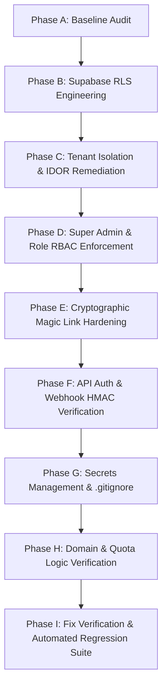

# Phase A: Security Baseline Audit Report — Choutuppal Franchise CRM

**Date**: 2026-10-25  
**Auditor**: Principal Application Security Engineer & Multi-Tenant SaaS Architect  
**Target Codebase**: `/data/user/0/com.termux/files/home/storage/downloads/Cpl Crm/choutuppal-franchise-crm`  
**Classification**: Internal Security Assessment & Hardening Baseline  

---

## 1. Confirmed Architecture & Technology Stack

| Dimension | Observed Implementation | Verification Details |
| :--- | :--- | :--- |
| **Framework** | Next.js 15.1.0 (App Router), React 19.0.0 | Verified in `package.json` |
| **Language & Runtime** | TypeScript 5.7.3, Node.js v26.4.0 (Linux/Termux) | Confirmed via `node -v` |
| **Database Architecture** | Dual Engine: Local JSON Store (`data/admin_data.json`) + PostgreSQL Schema (`supabase/schema.sql`) | Active reads/writes via `src/lib/store.ts` |
| **Authentication System** | Hybrid: Supabase Auth client (`@supabase/supabase-js`, `@supabase/ssr`) + In-memory/JSON Magic Link generator (`src/lib/store.ts`) | Fallback logic allows unverified logins |
| **Multi-Tenant Model** | Shared database with `territory_id` column across entities; in-memory host resolver in `src/lib/tenant.ts` | 1 Flagship (`territory_choutuppal`) + Franchise Towns |
| **Storage Engine** | AWS S3 SDK for Cloudflare R2 (`@aws-sdk/client-s3`) + local Unsplash fallbacks | Presigned URLs via `/api/upload/r2` |
| **WhatsApp Integration** | Meta WhatsApp Cloud API via `src/lib/whatsapp-cloud-api.ts` & Webhook in `/api/whatsapp/webhook` | Verification token in GET; no HMAC check in POST |
| **API Endpoints** | 13 Route Handlers in `src/app/api/` (Next.js App Router `route.ts`) | No Next.js middleware present |

---

## 2. Inventory of Security-Sensitive Components

1. **`src/app/api/admin/franchises/route.ts`**:
   - Manages franchise lifecycle (`create`, `update_status`, `update_plan`).
   - Sets activation, 1-year expiry, and suspension.
   - Currently unprotected: no session check, no role check.
2. **`src/app/api/admin/approvals/route.ts`**:
   - Moderation approval queue for listings, stories, and franchise applications.
   - Direct publication to website and WhatsApp bots.
   - Currently unprotected: arbitrary callers can approve/reject records.
3. **`src/app/api/admin/listings/route.ts`**:
   - CRUD operations on business listings across all territories.
   - Enforces plan quota (`maxListings`) on POST, but lacks caller authorization and allows cross-tenant updates/deletions.
4. **`src/app/api/auth/magic-link/route.ts` & `src/lib/store.ts`**:
   - Generates and verifies single-use WhatsApp login tokens.
   - Generates tokens using insecure `Math.random()`.
   - Stores unhashed tokens; no rate-limiting or anti-brute-force controls.
5. **`src/app/api/whatsapp/webhook/route.ts`**:
   - Receives inbound Meta WhatsApp webhooks.
   - Verifies token on GET, but lacks `X-Hub-Signature-256` HMAC validation on POST.
   - Processes vendor claims and listing submissions without cryptographic signature checks.
6. **`src/lib/tenant.ts`**:
   - In-memory tenant resolver using `Host` header with 5-minute TTL cache.
   - Vulnerable to host header spoofing if reverse proxy headers are trusted blindly.
7. **`supabase/schema.sql`**:
   - DDL for multi-tenant PostgreSQL tables.
   - **Critical Gap**: Row Level Security (RLS) is NOT enabled (`ALTER TABLE ... ENABLE ROW LEVEL SECURITY` is missing on all tables).
   - Zero `CREATE POLICY` definitions present.

---

## 3. Existing Protections (Verified Working)

- **Flagship Choutuppal Protection**:
  - The API specifically blocks attempts to create a franchise with slug `choutuppal` or `territory_choutuppal`.
  - The status update API explicitly prevents setting status to `suspended` for `FLAGSHIP_TERRITORY_ID` (returns HTTP 403).
- **Territory & Domain Collision Prevention**:
  - Duplicate territory slugs are rejected in `/api/admin/franchises`.
  - Duplicate domain mappings are blocked if already registered in `store.territoryDomains`.
- **Franchise Plan Quota Enforcement**:
  - `POST /api/admin/listings` validates `currentCount >= maxListings` for non-flagship territories and rejects excess listings with HTTP 403.
- **Audit Logging**:
  - Privileged lifecycle events (`FRANCHISE_CREATED`, `FRANCHISE_STATUS_ACTIVE`, `FRANCHISE_STATUS_SUSPENDED`, `FRANCHISE_PLAN_UPDATED`) call `logAuditEvent()` and append tamper-evident entries.

---

## 4. Missing or Unverified Protections (High Risk Gaps)

1. **Complete Absence of Server-Side API Authentication**:
   - All `/api/admin/*` routes (`franchises`, `listings`, `approvals`, `content`, `dashboard`) execute without verifying JWTs, sessions, or HTTP cookies.
   - Anyone sending a `curl -X POST /api/admin/franchises` can provision or suspend franchises.
2. **Missing Next.js Route Protection Middleware**:
   - No `middleware.ts` exists. Navigating to `/admin`, `/admin/dashboard`, or `/crm` directly in a browser does not require a valid session.
3. **No Database RLS in `supabase/schema.sql`**:
   - `schema.sql` creates tables but does not enable RLS or define any security policies. If deployed to Supabase, anonymous clients using the public anon key could read or modify all tables.
4. **Insecure Magic Link Token Generation & Storage**:
   - Tokens are generated using `Math.random().toString(36)`.
   - Tokens are stored in plaintext in `store.magicTokens`.
   - Tokens can be forged or predicted; no cryptographic randomness (`crypto.randomBytes`).
   - Magic link verification does not issue an HTTP-only secure cookie or authenticated session.
5. **No Webhook Signature Verification**:
   - `POST /api/whatsapp/webhook` processes inbound payloads without validating `X-Hub-Signature-256` HMAC.
6. **Unrestricted File Uploads in `/api/upload/r2`**:
   - No authentication, file extension allowlist, MIME-type verification, or size limits.
7. **Unauthenticated WhatsApp Dispatch in `/api/whatsapp/send`**:
   - Any external client can trigger outbound WhatsApp messages using the platform's credentials.
8. **Lack of `.gitignore` for Local Secrets**:
   - No `.gitignore` file exists; local environment files (`.env.local`) risk accidental commit to Git.

---

## 5. Test Environment & Operational Limitations

- **Operating Environment**: Linux (Android Termux environment).
- **Database Context**: The development runtime uses JSON store (`data/admin_data.json`). Supabase PostgreSQL schema exists in `supabase/schema.sql` for deployment.
- **WhatsApp Webhook Testing**: Direct live WhatsApp messaging is mocked/isolated; tests must use simulated HTTP payloads with HMAC signatures.
- **Safety Directive**:
  - Never execute destructive migrations or delete production records.
  - Never send real WhatsApp messages to live phone numbers.
  - Test all attack scenarios against isolated staging payloads and automated verification scripts.

---

## 6. Git State Before Modifications

- **Branch**: `master`
- **Initial Baseline Commit**: `chore: baseline state before security audit` (tracked clean working tree)
- **Files Tracked**: All source files, tests, assets, and documentation.

---

## 7. Risk-Ranked Security Audit & Remediation Plan

| Priority | Phase / Focus Area | Critical Targets |
| :--- | :--- | :--- |
| **P0 (Critical)** | **Phase E**: Magic Link Security | Replace `Math.random` with `crypto.randomBytes(32)`, hash stored tokens (SHA-256), issue secure HTTP-only session cookies. |
| **P0 (Critical)** | **Phase F**: API Auth & Middleware | Implement `src/middleware.ts` to protect `/admin` and `/crm`; implement JWT/session validation helper for all `/api/admin/*` endpoints. |
| **P0 (Critical)** | **Phase B**: Supabase RLS Hardening | Rewrite `supabase/schema.sql` to enable RLS on all 11 tables with granular SELECT, INSERT, UPDATE, DELETE policies. |
| **P1 (High)** | **Phase C & D**: IDOR & Tenant Isolation | Enforce caller `territoryId` checks across `/api/admin/listings`, `/api/admin/approvals`, `/api/admin/content`, and `/api/crm/contacts`. |
| **P1 (High)** | **Phase F**: WhatsApp Webhook HMAC | Validate `X-Hub-Signature-256` using `crypto.createHmac('sha256', appSecret)`. |
| **P2 (Medium)** | **Phase G**: Secrets & Config | Create `.gitignore` to prevent secret leakage; audit all references to private tokens. |
| **P2 (Medium)** | **Phase H**: Upload & Send Guards | Restrict `/api/upload/r2` and `/api/whatsapp/send` to authenticated admin callers. |
| **P0 (Validation)**| **Phase I**: Regression Test Suite | Expand `test_franchise_platform.py` into a complete security regression suite testing IDOR, token brute-force, forgery, and RLS. |
