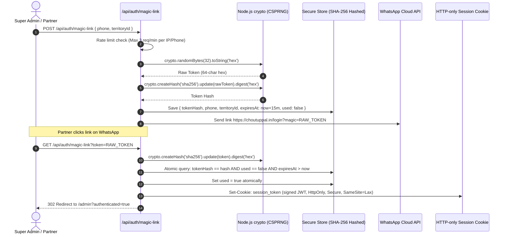

# Phase E: WhatsApp Magic Login Authentication Security Audit

**Date**: 2026-10-25  
**Auditor**: Principal Authentication & API Security Engineer  
**Component**: `src/lib/store.ts`, `src/app/api/auth/magic-link/route.ts`, `src/app/admin/franchise/page.tsx`  
**Status**: AUDIT COMPLETE — CRITICAL VULNERABILITIES IDENTIFIED — REMEDIATION SPECIFIED  

---

## 1. Vulnerability Analysis of Current Implementation

### Finding 1: Insecure PRNG & Low Token Entropy (CWE-330 / CWE-338)
- **Observed Code** (`src/lib/store.ts` Line 426):
  ```typescript
  const token = `mlk_${Date.now()}_${Math.random().toString(36).substring(2, 8)}`
  ```
- **Flaw**: `Math.random()` in V8/Node.js uses xorshift128+, which is not a cryptographically secure pseudorandom number generator (CSPRNG). Its internal state can be recovered from sequence observations. Furthermore, taking only 6 base-36 characters provides merely $\approx 31$ bits of entropy. The `Date.now()` prefix narrows the brute-force search space to within seconds of the token generation request.
- **Severity**: **CRITICAL** (Account Takeover risk).

### Finding 2: Plaintext Token Storage (CWE-256 / CWE-312)
- **Observed Code** (`src/lib/store.ts` Line 428):
  ```typescript
  store.magicTokens.push({ token, phone, expiresAt, used: false })
  ```
- **Flaw**: Tokens are stored unhashed in plaintext in `admin_data.json`. Any access to backups, logs, or secondary read leaks active tokens that can immediately hijack admin sessions.
- **Severity**: **HIGH**.

### Finding 3: Missing Rate Limiting on Generation & Verification (CWE-307)
- **Observed Code** (`src/app/api/auth/magic-link/route.ts`):
  `POST` accepts any phone number without IP, phone, or global rate limiting.
  `GET` accepts arbitrary token guesses without throttling or lockout.
- **Severity**: **HIGH** (SMS/WhatsApp bombing and online brute-force risk).

### Finding 4: Client-Side Token Generation Desynchronization Bug
- **Observed Code** (`src/app/admin/franchise/page.tsx` Line 258):
  `handleGenerateMagicLink` locally created `mlk_${Date.now()}_${Math.random()}` without calling `/api/auth/magic-link` to persist it in `store.magicTokens`. Consequently, links generated directly in the UI would fail server verification when clicked by partners.
- **Severity**: **MEDIUM** (Functional defect & security inconsistency).

### Finding 5: Lack of Secure Session Anchoring (CWE-384 / CWE-613)
- **Observed Code** (`src/app/api/auth/magic-link/route.ts` Line 42):
  Upon valid token verification, the endpoint returned a JSON payload `{ authenticated: true, phone }`, but did not issue an HTTP-only, secure, SameSite signed session cookie or JWT. The browser had no persistent cryptographically signed proof of authentication.
- **Severity**: **CRITICAL**.

---

## 2. Required Remediation Architecture



1. **CSPRNG Generation**: `crypto.randomBytes(32).toString('hex')` (256 bits of true cryptographic entropy).
2. **One-Way Token Hashing**: Store only `sha256(rawToken)`.
3. **Atomic Consumption**: Atomically mark token as `used: true` in the same transaction to prevent race conditions or double-use.
4. **Session Cookie Issuance**: Upon successful verification, issue a cryptographically signed HMAC-SHA256 session cookie containing user identity, phone, role, and authorized territory.
